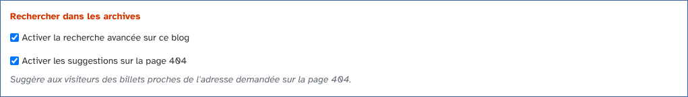
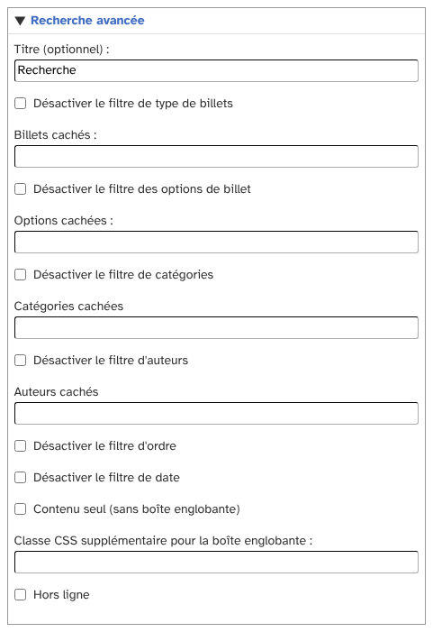
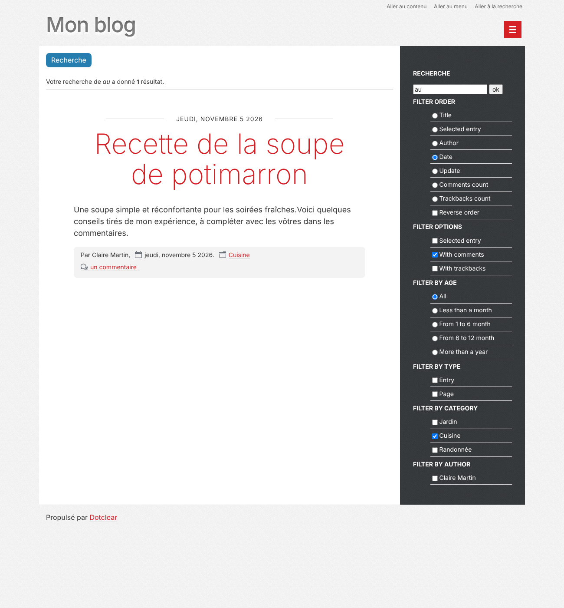
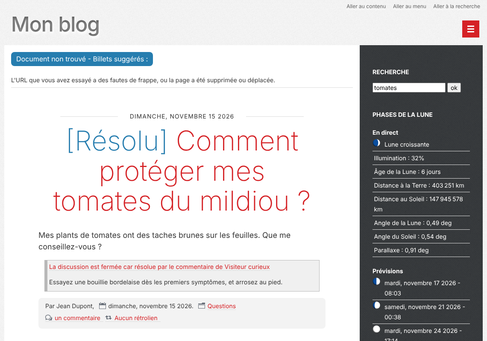

# saba : guide d'utilisation

saba remplace la page de recherche publique et la page « Document non trouvé » (404) par une page qui propose des billets au visiteur. Il ajoute aussi un widget de recherche avancée, avec des filtres.

## Sommaire

* [Activer le plugin](#activer-le-plugin)
* [Ajouter le widget de recherche avancée](#ajouter-le-widget-de-recherche-avancée)
* [Les filtres de la recherche](#les-filtres-de-la-recherche)
* [Les suggestions sur la page 404](#les-suggestions-sur-la-page-404)
* [Thème personnalisé](#thème-personnalisé)
* [Bon à savoir](#bon-à-savoir)

## Activer le plugin

1. Allez dans « Paramètres du blog ».
2. Ouvrez « Paramètres des plugins pour ce blog ».
3. Dans la section « Rechercher dans les archives », cochez :
   * « Activer la recherche avancée sur ce blog » ;
   * « Activer les suggestions sur la page 404 », si vous voulez des suggestions quand une adresse n'existe pas.
4. Enregistrez.

Tant que la première case n'est pas cochée, le plugin ne fait rien.

## Ajouter le widget de recherche avancée

1. Allez dans « Widgets ».
2. Dans la liste des widgets disponibles, choisissez « Recherche avancée », puis ajoutez-le à la zone de votre choix.
3. Ouvrez le widget pour le régler, puis enregistrez.

Réglages du widget :

* « Titre (optionnel) » : le titre au-dessus du champ de recherche.
* « Désactiver le filtre par type » et « Types cachés » : retire le filtre par type, ou seulement certains types (`post`, `page`…).
* « Désactiver le filtre par option » et « Options cachées » : retire le filtre par option, ou seulement certaines options (`selected`, `comment`, `trackback`).
* « Désactiver le filtre par catégorie » et « Catégories cachées » : retire le filtre par catégorie, ou seulement certaines catégories, désignées par leur adresse ou leur numéro.
* « Désactiver le filtre par auteur » et « Auteurs cachés » : retire le filtre par auteur, ou seulement certains auteurs, désignés par leur identifiant.
* « Désactiver le tri » et « Désactiver le filtre par date » : retirent le tri et le filtre par ancienneté.
* Les réglages habituels des widgets : contenu seul, classe CSS, hors ligne.

Pour cacher plusieurs éléments, séparez-les par des virgules. Les espaces autour des virgules sont ignorés.

## Les filtres de la recherche

Le champ de recherche du widget est affiché partout. Les filtres n'apparaissent que sur la page des résultats de recherche. Ils se combinent avec le mot cherché :

* le tri : titre, billet sélectionné, auteur, date, mise à jour, nombre de commentaires, nombre de rétroliens, avec une case pour inverser l'ordre ;
* les options : billet sélectionné, avec commentaires, avec rétroliens ;
* l'ancienneté : moins d'un mois, de 1 à 6 mois, de 6 à 12 mois, plus d'un an ;
* le type : billet ou page, et les types des plugins qui en ajoutent un (événements d’eventHandler, sondages de pollsFactory) ;
* les catégories ;
* les auteurs.

Cochez les filtres voulus, puis validez avec le bouton « ok » du champ de recherche.

## Les suggestions sur la page 404

Quand un visiteur ouvre une adresse qui n'existe pas, saba reprend les mots de l'adresse et cherche les billets qui les contiennent. Il les affiche sous le titre « Document non trouvé - Billets suggérés : », et pré-remplit le champ de recherche avec ces mots.

Par exemple, l'adresse `/jardin/hiver` propose les billets qui parlent de jardin et d'hiver, et l'adresse `/tomates` ceux qui parlent de tomates.

La page reste envoyée avec le code HTTP 404 : les moteurs de recherche savent que l'adresse n'existe pas.

Si aucun billet ne correspond, le visiteur voit la page 404 habituelle de votre thème.

## Thème personnalisé

Le plugin fournit ses gabarits pour les jeux de gabarits de Dotclear (dotty et mustek) : ceux de votre thème sont choisis automatiquement. Si votre thème a ses propres gabarits, copiez les gabarits du dossier `default-templates` du plugin dans votre thème, et adaptez-les.

## Bon à savoir

* Sur la page 404, le widget n'affiche que le champ de recherche, sans les filtres.
* Les mots de l'adresse sont séparés par `/`, `-`, `_`, les virgules et les espaces.
